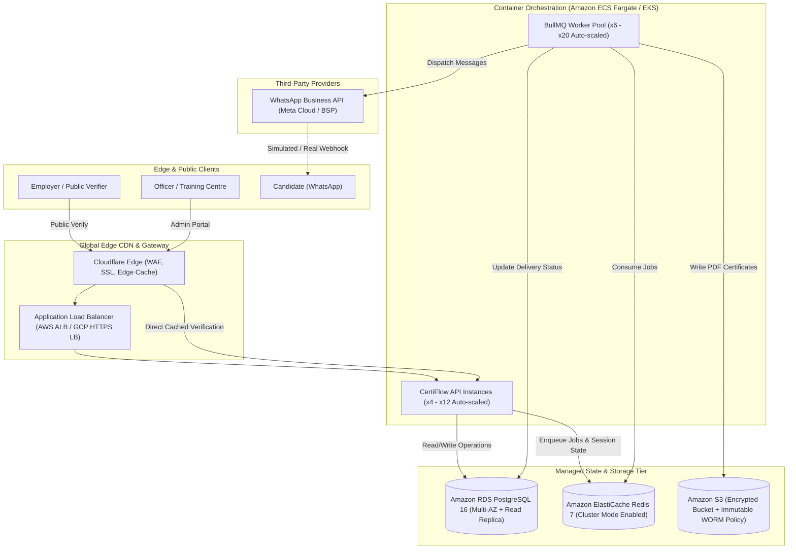

# CertiFlow – Production Architecture & Deployment Plan

This document details the production engineering, hosting topology, scaling characteristics, failure containment, security policies, and cost projections for the **CertiFlow Platform** operating at national/state scale.

---

## 1. Scale Targets & Workload Characteristics

| Dimension | Target Specification | Design Implication |
| :--- | :--- | :--- |
| **User Base** | 100,000 registered users, 10,000 DAU | Low-latency session management via stateless JWTs + Redis token denylist. |
| **Peak Throughput (Results Day)** | ~500 batches approved in 1 hour | **30,000 PDF certificates** to generate and **30,000 WhatsApp dispatches** to process within 60 minutes (~8.3 PDFs/sec sustained, bursts of ~30/sec). |
| **Public Verification** | Millions of requests annually, bursty | Read-heavy, cacheable public verification portal served via global edge CDN. |
| **Target Availability** | 99.95% uptime | Multi-AZ deployment, automated health checks, blue-green deployment pipeline. |

---

## 2. Production Architecture Diagram



---

## 3. Component Hosting Strategy

### 1. Frontend & Public Verification
- **Hosting**: AWS S3 + Cloudflare CDN (or Vercel / Cloudflare Pages).
- **Why**: Static Single-Page Application (SPA) assets have near-zero server overhead. Edge caching guarantees sub-50ms TTFB worldwide for employers checking candidate credentials.

### 2. Core API Cluster
- **Hosting**: AWS ECS on Fargate (Containerized Docker images across 3 Availability Zones).
- **Why**: Serverless container execution eliminates OS maintenance, patches automatically, and scales horizontally in response to CPU/Memory utilization (> 70% target).

### 3. Background Processing Pool (BullMQ Workers)
- **Hosting**: Separate AWS ECS Fargate autoscaling task family pinned to the `certificate-whatsapp-delivery` queue.
- **Why**: Separates heavy CPU-bound tasks (PDFKit vector drawing, font rendering, QR encoding) from the HTTP request-response loop, guaranteeing that government officers never experience UI slowdowns during mass batch approvals.

### 4. Primary Relational Database
- **Hosting**: AWS Aurora PostgreSQL 16 (Multi-AZ cluster: 1 Primary Writer, 1 Read Replica for public lookups).
- **Why**: ACID transaction guarantees for batch uploads, optimistic row-locking concurrency, and automated point-in-time recovery (PITR).

### 5. In-Memory Queue & Cache
- **Hosting**: AWS ElastiCache for Redis 7 (Multi-AZ with auto-failover enabled).
- **Why**: High-throughput message queuing (< 1ms latency) for BullMQ job scheduling, rate limiting, and fast verification caching.

### 6. Certificate Storage
- **Hosting**: AWS S3 with Server-Side Encryption (SSE-KMS) and S3 Object Lock (Write Once Read Many).
- **Why**: Tamper-proof permanent record keeping with 99.999999999% durability.

---

## 4. Scaling & Backlog Clearance (Results Day Peak)

### Handling 30,000 PDFs & WhatsApp Deliveries in 1 Hour:
- **Baseline Worker Capacity**: Each worker container handles ~5 concurrent PDF renders. Single PDFKit rendering time is ~180ms.
- **Throughput per Container**: $\approx 25 \text{ PDFs/second}$ per 4-vCPU worker container.
- **Autoscaling Policy**:
  - CloudWatch monitors the BullMQ queue metric `ApproximateNumberOfMessagesVisible`.
  - When queue depth exceeds 200 jobs, auto-scaling triggers additional worker containers (scaling from 4 baseline to 16 worker tasks).
  - 16 workers process $\sim 400 \text{ PDFs/second}$, draining a peak batch of 30,000 certificates in under **10 minutes**, well within the 1-hour requirement.
- **Rate-Limiting Upstream WhatsApp Dispatches**:
  - Meta WhatsApp Business API enforces rate tiers (Tier 1: 1,000 msgs/day; Tier 2: 10,000 msgs/day; Tier 3: 100,000 msgs/day).
  - BullMQ rate-limiter tokens restrict outbound dispatches to compliant pacing (e.g. 80 msgs/sec) to avoid carrier throttling.

---

## 5. Failure Handling & Resilience Matrix

| Failure Event | System Response & Self-Healing Mechanism |
| :--- | :--- |
| **Worker Container Crash** | BullMQ locks the job with a visibility lease timeout (30 seconds). If a worker crashes midway through generating a certificate, the lock expires, and another healthy worker automatically re-claims the job. The idempotency key prevents duplicate records. |
| **Redis Restart / Outage** | Redis runs in Multi-AZ cluster mode with automated failover (< 15 seconds replica promotion). The API gracefully falls back to inline synchronous dispatch if Redis is temporarily unreachable. |
| **WhatsApp Provider Outage / 504 Timeout** | BullMQ workers catch upstream timeouts and mark the job status as `RETRYING`. Jobs execute automatic exponential backoff (retry after 2s, 4s, 8s). If all 3 attempts fail, status transitions to `FAILED` with the exact carrier error logged, allowing manual one-click retry from the admin console. |
| **Slow Database / Connection Exhaustion** | AWS RDS Proxy connection pooling sits between the API/Workers and PostgreSQL, managing up to 10,000 idle client handles without exhausting PostgreSQL's `max_connections`. Long-running analytical queries are directed to the Read Replica. |

---

## 6. Certificate Storage, Security & Access Control

- **Storage Structure**: Certificates are stored at `s3://certiflow-production-certs/YYYY/MM/{batchId}/{certificateNumber}.pdf`.
- **Pre-signed URLs**: All direct client PDF downloads utilize time-expiring (15-minute) AWS S3 pre-signed URLs generated on-the-fly by the backend API.
- **Cryptographic Hashing**: Each certificate metadata record stores a SHA-256 hash of the generated PDF binary in PostgreSQL. Any modified PDF will fail hash validation upon verification.
- **Data Privacy (PII Protection)**: Public verification reveals only the candidate's name, course, training centre, and grade. Sensitive personal identifiers (such as Aadhaar or mobile numbers) are masked or strictly omitted from public views.

---

## 7. Monitoring, Observability & Alerting

- **APM & Metrics**: OpenTelemetry collector forwarding traces and metrics to Prometheus & Grafana.
- **Key Metrics Tracked**:
  - `certiflow_batch_approval_duration_seconds`
  - `certiflow_queue_delay_seconds`
  - `certiflow_delivery_failure_rate`
  - `certiflow_stuck_batches_count` (alerts if batch > 48 hours untouched)
- **Log Management**: Centralized structured JSON logging in AWS CloudWatch / Datadog.
- **Alerting**: PagerDuty integration for:
  - Error rate > 1% over 5 minutes.
  - Redis memory utilization > 80%.
  - BullMQ dead-letter queue > 10 failed deliveries.

---

## 8. Monthly Cost Estimate & Trade-offs

| Infrastructure Component | Sizing / Configuration | Estimated Monthly Cost |
| :--- | :--- | :--- |
| **AWS ECS Fargate** | 4-12 API tasks, 4-16 Worker tasks (2 vCPU, 4GB RAM) | $420 |
| **AWS Aurora PostgreSQL** | `db.r6g.large` (Multi-AZ) + Read Replica | $380 |
| **AWS ElastiCache Redis** | `cache.m6g.large` (Multi-AZ, 2 nodes) | $190 |
| **Amazon S3 & Data Transfer** | 500GB storage, 2TB outbound bandwidth | $65 |
| **Cloudflare Business / Enterprise** | WAF, DDoS protection, edge caching | $200 |
| **CloudWatch / Monitoring** | Metrics, logs, alerting | $85 |
| **Total Estimated Monthly Cost** | | **~$1,340 / month** |

### Strategic Trade-offs:
1. **Managed Serverless Containers (Fargate) vs. Self-hosted EC2/K8s**:
   - *Choice*: Fargate costs ~15% more than raw EC2 instances, but completely removes the operational overhead of Kubernetes cluster management and node patching, allowing a solo developer or lean government team to maintain high availability with zero DevOps toil.
2. **Multi-AZ Aurora PostgreSQL vs. Single Instance**:
   - *Choice*: Aurora Multi-AZ doubles database costs, but provides zero-downtime failover and protection against data loss for legal educational credentials.

---

## 9. Modular WhatsApp Delivery: Simulation Mode vs. Meta Cloud API Upgrade Path

To guarantee a reliable, deterministic hackathon presentation without relying on live Meta Business verification or credit card billing gates, CertiFlow implements a **Pluggable Delivery Provider Architecture**.

### 1. Delivery Provider Architecture
```
                           BullMQ Delivery Worker
                                      │
                         IDeliveryProvider Interface
                                      │
                 ┌────────────────────┴────────────────────┐
                 ▼                                         ▼
      SimulatedDeliveryProvider               MetaWhatsAppCloudProvider
      (WHATSAPP_DELIVERY_MODE=DEMO_SIMULATION) (WHATSAPP_DELIVERY_MODE=META_CLOUD_API)
      - Realistic Telco Latency (300ms)         - Meta Graph API v19.0
      - Deterministic Gateway Timeout Retry     - Official Template Messaging
      - Generates wamid.SIM_... receipts        - Verified WABA Certificate PDF Attachment
      - Zero External API / Billing Risk       - Live Candidate WhatsApp Delivery
```

### 2. Upgrading to Live Meta WhatsApp Cloud API Post-Hackathon
Transitioning from demo simulation to live WhatsApp delivery requires **zero rewrites** to the batch approval pipeline, PDF generation service, or database schema:
1. Obtain official Meta Business credentials:
   - `META_WHATSAPP_TOKEN`: System User Permanent Access Token with `whatsapp_business_messaging` permissions.
   - `META_PHONE_NUMBER_ID`: Verified WhatsApp Business phone number ID.
   - `META_WABA_ID`: WhatsApp Business Account ID.
2. In the deployment environment (`.env` / AWS SSM Parameter Store / ECS Task Definition):
   ```bash
   WHATSAPP_DELIVERY_MODE="META_CLOUD_API"
   META_WHATSAPP_TOKEN="EAAG..."
   META_PHONE_NUMBER_ID="109876543210"
   ```
3. Restart the container tasks: `DeliveryProviderFactory` dynamically instantiates `MetaWhatsAppCloudProvider` and routes all subsequent BullMQ delivery jobs to the official Meta Cloud API endpoints.


