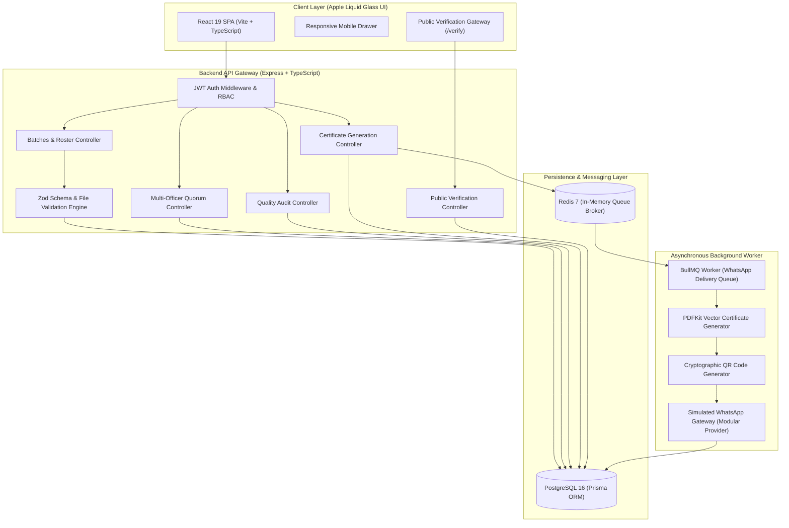
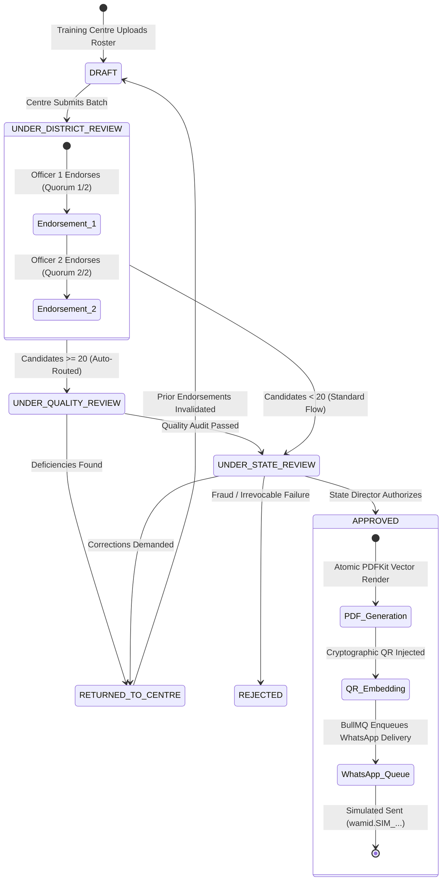

# CertiFlow – Smart Certificate Issuance & Verification Platform
**Next-Generation Multi-Tier Skill Certification, Governance, and Cryptographic Verification Platform**  
*Built for the Pragati Skills Mission – State Directorate of Vocational Training*

[](https://www.typescriptlang.org/)
[](https://react.dev/)
[](https://nodejs.org/)
[](https://www.postgresql.org/)
[](https://redis.io/)
[](https://bullmq.io/)
[](https://www.prisma.io/)
[](https://tailwindcss.com/)
[](https://github.com/Chanikya-Sanapala/CertiFlow-s)

---

## 1. Executive Summary & Problem Understanding

The **Pragati Skills Mission** trains over 8,000 candidates every month across 300+ accredited vocational institutions. Historically, candidate pass sheets were emailed across fragmented district desks, batch approvals were coordinated ad-hoc over messaging apps, and certificates were typed manually into desktop text processors. 

This legacy process created critical structural vulnerabilities:
1. **Administrative Latency**: Weeks of delay before certified trainees received proof of training required for job placement.
2. **Zero Non-Repudiation**: No verifiable, immutable audit trail of which specific officer endorsed candidate marks or verified attendance.
3. **Counterfeit Vulnerabilities**: Employers had no cryptographically signed, real-time method to distinguish authentic government credentials from forged copies.
4. **Data Corruption & Half-Saved Records**: Spreadsheets containing bad phone numbers, duplicate National IDs, or corrupted marks caused silent database failures or partial ingestion.
5. **Batch Stagnation**: Student rosters lingered untouched on officer desks for days without automated monitoring or escalation.

### How CertiFlow Solves This
CertiFlow replaces paper and email-based workflows with an end-to-end, multi-tier digital governance pipeline featuring:
- **Strict Atomic Ingestion** with row-level validation and complete rollback on any malformed record.
- **2-Officer Multi-Signature District Quorum** with optimistic concurrency guards.
- **Automated Quality Threshold Routing** for high-volume or flagged student batches.
- **Asynchronous Certificate Generation & Idempotent WhatsApp Delivery Simulation** powered by BullMQ and Redis.
- **Public Zero-Login Cryptographic QR Verification & Instant Revocation**.
- **Automated 48-Hour SLA Stagnation Monitoring** for file oversight.

---

## 2. System Architecture & Component Model

CertiFlow follows a modern, decoupled microservices-inspired architecture designed for high throughput, data integrity, and complete non-repudiation:



### Architectural Highlights
- **Optimistic Locking**: Every batch record tracks an incremental `version` integer. When two district officers review a batch concurrently, database transactions guarantee atomic updates and prevent duplicate state advancement.
- **Idempotency Keys**: WhatsApp delivery jobs enforce unique idempotency hashes (`${certNumber}_WA`) in Redis and PostgreSQL, ensuring a candidate is never sent duplicate messages during background retries.
- **Pluggable Delivery Gateway**: Clean separation of concerns between BullMQ queue processing and message transmission. CertiFlow includes a realistic `SimulatedDeliveryProvider` with retry backoff and can switch to the official Meta Cloud API v19.0 with a single environment flag (`WHATSAPP_DELIVERY_MODE=META`).

---

## 3. Technology Stack & Rationale

| Layer | Technologies | Technical & Architectural Rationale |
| :--- | :--- | :--- |
| **Frontend** | React 19, Vite, TypeScript, Tailwind CSS v4, Lucide React | High-performance SPA with instant hot module replacement, zero-runtime typing safety, and modern responsive layouts. |
| **Design Language** | Apple-Inspired Liquid Glass UI | Frosted-glass surfaces (`backdrop-blur`), soft shadows, translucent toolbars, and minimalist typography using **Inter** (#1F2E4A Deep Navy, #343A40 Charcoal, #CED4DA Soft Grey, #F8F9FA Off-white). |
| **Backend API** | Node.js 20+, Express.js, TypeScript | Clean modular architecture, centralized async error boundary, strict request typing, and predictable RESTful design. |
| **Database & ORM** | PostgreSQL 16, Prisma 6 ORM | ACID transactional integrity, relational foreign keys, row-level concurrency locking, automated schema migrations, and full type safety. |
| **Queue & Cache** | Redis 7, BullMQ | Non-blocking asynchronous job orchestration for heavy PDF vector rendering, QR generation, and automated delivery retries. |
| **Authentication & Security** | JWT (JSON Web Tokens), bcryptjs (salt rounds 10), HTTP headers | Stateless session tokens, pre-registered official email enforcement, password hashing, and server-side RBAC. Client-side role selection is strictly disabled. |
| **Ingestion & Validation** | xlsx, Zod | Excel roster parsing with cell-level type coercion, regex pattern validation (Aadhaar, Indian mobile), and transactional atomic rollback. |
| **Certificate & QR Engine** | PDFKit, qrcode | Server-side vector PDF document compilation with high-density, error-corrected QR codes pointing to live verification endpoints. |
| **Infrastructure** | Docker, Docker Compose | Reproducible multi-container environments running isolated PostgreSQL 16 and Redis 7 instances. |

---

## 4. End-to-End Governance Lifecycle & Working Flow

Every training batch in CertiFlow traverses a strict, multi-stage governance pipeline:



### Detailed Stage Breakdown

#### Stage 1: Candidate Ingestion & Validation (Training Centre)
- **Actor**: Training Centre Officer (`training.centre@certiflow.gov`)
- **Function**: The training centre uploads candidate rosters via spreadsheet (`.xlsx`).
- **Validation Engine**:
  - Full Name & Father's Name (string sanitization, min 2 chars).
  - National ID / Aadhaar (12 numeric digits with duplicate prevention within batch).
  - Indian Mobile Phone (`9XXXXXXXXX`, handles `+91` normalization).
  - Assessment Marks (numeric range 0–100, pass threshold ≥ 40).
  - Attendance Percentage (numeric range 0–100, pass threshold ≥ 75%).
- **Atomic Rollback Guarantee**: If even one row fails validation, the entire transaction rolls back. Nothing is partially saved, and the UI displays the exact row number and invalid field.

#### Stage 2: District Multi-Officer Quorum & Concurrency Control
- **Actors**: District Officer 1 (`district.officer1@certiflow.gov`) & District Officer 2 (`district.officer2@certiflow.gov`)
- **Function**: Eliminates single-officer bias or corruption by requiring **at least two distinct district officers** (`REQUIRED_DISTRICT_APPROVALS = 2`) to endorse the batch.
- **Security Protections**:
  - *Anti-Double Endorsement*: The same officer cannot approve a batch twice.
  - *Optimistic Concurrency Guard*: Uses PostgreSQL row versioning to reject concurrent simultaneous approvals without race conditions.

#### Stage 3: Automated Quality Assurance Routing
- **Actor**: Quality Reviewer (`quality.reviewer@certiflow.gov`)
- **Function**: Batches with high candidate volumes (≥ 20 candidates) or flagged assessment metrics are automatically diverted to the Quality Directorate before reaching the State Office.
- **Audit Scope**: Audits marks distributions, practical evaluation logs, and attendance rosters. Can approve or return for correction.

#### Stage 4: State Director Final Authorization & Issuance
- **Actor**: State Director (`state.director@certiflow.gov`)
- **Function**: Conducts final executive review of all prior endorsements and authorizes certificate issuance.
- **Asynchronous Execution**:
  - Generates tamper-proof vector PDF certificates using **PDFKit**.
  - Injects cryptographically signed verification QR codes linking to `/verify?certNumber=...`.
  - Dispatches background delivery jobs to Redis via **BullMQ**.

#### Stage 5: WhatsApp Delivery Simulation Mode
- **System Worker**: BullMQ Background Worker (`src/workers/delivery.worker.ts`)
- **Function**: Processes delivery jobs asynchronously without blocking the user interface.
- **Realistic Demo Simulation**:
  - Delivers certificates via simulated WhatsApp without requiring live Meta Cloud API billing.
  - Generates realistic WhatsApp message identifiers (`wamid.SIM_...`).
  - Simulates transient carrier network timeouts on attempt 1 to demonstrate automated exponential backoff and retry handling.
  - Displays clear indicator: *"DEMO MODE — WhatsApp delivery simulated. No actual message was sent."*

#### Stage 6: Public Zero-Login Verification & Anti-Fraud Gateway
- **Audience**: Prospective Employers, Embassies, Academic Institutions, General Public (`/verify`)
- **Function**: Anyone can verify certificate authenticity without creating an account or logging in:
  - Enter the certificate number manually or scan the QR code using any smartphone camera.
  - Displays verified student name, trade/course, grade, training centre, and official state signatories.
  - **Instant Revocation**: If the State Director revokes a certificate, the public portal immediately turns red and displays the revocation reason, timestamp, and signatory in real time.

#### Stage 7: Automated SLA Stagnation Monitoring
- **Function**: Batches remaining in an active review status for longer than 48 hours without officer action are automatically marked as **Stuck / Untouched Past SLA**.
- A prominent amber alert banner surfaces on the State Director and District Officer dashboards highlighting stagnant batches for immediate escalation.

---

## 5. Official Registered Accounts

CertiFlow employs strict server-side Role-Based Access Control (RBAC). In accordance with government security standards, client-side role toggling and 1-click demo logins are completely disabled. All testing uses official credentials authenticated against PostgreSQL bcrypt hashes:

| Official Role | Department & Jurisdiction | Registered Email | Password |
| :--- | :--- | :--- | :--- |
| **Training Centre** | Apex Skill Development Institute (District North) | `training.centre@certiflow.gov` | `Pass@1234` |
| **District Officer 1** | District Skills Office – North | `district.officer1@certiflow.gov` | `Pass@1234` |
| **District Officer 2** | District Skills Office – North | `district.officer2@certiflow.gov` | `Pass@1234` |
| **Quality Reviewer** | State Quality Assurance Directorate | `quality.reviewer@certiflow.gov` | `Pass@1234` |
| **State Director** | State Skills Mission Headquarters | `state.director@certiflow.gov` | `Pass@1234` |

*Public Verification does not require authentication: [http://localhost:3000/verify](http://localhost:3000/verify)*

---

## 6. Directory Structure & Key Files

```
CertiFlow/
├── backend/                             # Express & TypeScript Backend
│   ├── prisma/
│   │   ├── schema.prisma                # Database schema & relationships
│   │   └── migrations/                  # Historical database migrations
│   ├── src/
│   │   ├── config/                      # Database, Redis, and Constants
│   │   ├── middleware/                  # JWT auth & RBAC validation
│   │   ├── modules/
│   │   │   ├── auth/                    # Login & session verification
│   │   │   ├── batches/                 # Spreadsheet ingestion & state machine
│   │   │   ├── approvals/               # District quorum & signatures
│   │   │   ├── quality/                 # Quality audit routing
│   │   │   ├── certificates/            # PDF generation & public lookup
│   │   │   └── dashboard/               # Aggregate KPI queries & SLA alerts
│   │   ├── services/
│   │   │   ├── pdf.service.ts           # Vector PDF certificate compiler
│   │   │   ├── queue.service.ts         # BullMQ queue producer
│   │   │   └── delivery/                # Modular delivery provider interface
│   │   │       ├── delivery.interface.ts
│   │   │       ├── simulated.provider.ts# Demo WhatsApp simulation
│   │   │       └── meta.provider.ts     # Meta Cloud API integration
│   │   ├── workers/
│   │   │   └── delivery.worker.ts       # Background delivery job consumer
│   │   ├── clean.ts                     # Database cleanup utility
│   │   ├── seed.ts                      # Official accounts initializer
│   │   └── server.ts                    # HTTP server entrypoint
│   └── test/
│       ├── moments.test.ts              # 24 core moments automated verification
│       ├── security_audit.test.ts       # 40 security & RBAC tests
│       └── auth.test.ts                 # 23 authentication tests
│
├── frontend/                            # React 19 + Vite Frontend
│   ├── src/
│   │   ├── components/
│   │   │   ├── layout/                  # AppLayout, TopNav, responsive Sidebar
│   │   │   └── ui/                      # GlassCard, Button, Badge, Modal
│   │   ├── context/
│   │   │   └── AuthContext.tsx          # JWT session context & interceptors
│   │   ├── pages/
│   │   │   ├── LoginPage.tsx            # Apple split-screen manual login
│   │   │   ├── DashboardPage.tsx        # Role-based metrics & SLA alerts
│   │   │   ├── BatchesPage.tsx          # Roster upload & batch list
│   │   │   ├── BatchDetailPage.tsx     # Candidate roster & endorsement audit
│   │   │   ├── CertificatesPage.tsx     # Issued certificates & delivery stats
│   │   │   └── VerificationPage.tsx     # Public credential verification
│   │   └── services/
│   │       └── api.ts                   # Axios client with 401 redirect handler
│   └── index.html                       # HTML template with Inter typography
│
├── sample-data/                         # Live Reviewer Testing Files
│   ├── CertiFlow_Sample_Candidate_Batch.xlsx # 10 valid student records
│   ├── CertiFlow_Invalid_Test_Batch.xlsx    # Deliberate errors for validation demo
│   └── README.md                        # Step-by-step upload walkthrough
│
├── docker-compose.yml                   # PostgreSQL 16 & Redis 7 services
├── DEPLOYMENT.md                        # Production deployment guide
├── SETUP.md                             # Local development setup instructions
└── README.md                            # Complete platform documentation
```

---

## 7. Step-by-Step Live Reviewer Demonstration

For a hackathon demo or technical audit, use the sample workbooks in the `sample-data/` folder:

### Step 1: Candidate Upload & Atomic Rollback
1. Log in as `training.centre@certiflow.gov` (Password: `Pass@1234`).
2. Go to **Upload & Batches** ➔ **Upload Batch**.
3. First upload `sample-data/CertiFlow_Invalid_Test_Batch.xlsx`:
   - Demonstrate row-level error pinpointing (invalid phone, negative marks, duplicate Aadhaar).
   - Point out that **zero partial records** are created in PostgreSQL (Atomic Rollback).
4. Upload `sample-data/CertiFlow_Sample_Candidate_Batch.xlsx`:
   - 10 candidate rows are validated and committed under `BATCH-2026-0001` with status **Under District Review**.
5. Sign out.

### Step 2: District Multi-Officer Quorum
1. Log in as `district.officer1@certiflow.gov` (Password: `Pass@1234`).
2. Open **District Approvals** ➔ Select `BATCH-2026-0001` ➔ Click **Endorse Batch**.
3. Quorum displays **1 of 2 Endorsements Recorded**. Notice that Officer 1 cannot click approve again.
4. Sign out and log in as `district.officer2@certiflow.gov` (Password: `Pass@1234`).
5. Open `BATCH-2026-0001` ➔ Click **Endorse Batch**.
6. Quorum reaches **2/2**; the batch advances to **Under Quality Review**. Sign out.

### Step 3: Quality Review Audit
1. Log in as `quality.reviewer@certiflow.gov` (Password: `Pass@1234`).
2. Open **Quality Review** ➔ Select `BATCH-2026-0001`.
3. Review marks distribution and syllabus adherence ➔ Click **Submit Quality Audit (Pass)**.
4. The batch advances to **Under State Review**. Sign out.

### Step 4: State Final Approval & WhatsApp Delivery Simulation
1. Log in as `state.director@certiflow.gov` (Password: `Pass@1234`).
2. Open **Batches** ➔ Select `BATCH-2026-0001` ➔ Click **Final Approval & Issue Certificates**.
3. The platform renders 10 vector PDF certificates and queues background delivery jobs in BullMQ.
4. Navigate to **Certificates**:
   - Notice the banner: *"DEMO MODE — WhatsApp delivery simulated. No actual message was sent."*
   - Observe simulated message IDs (`wamid.SIM_...`) and retry recovery handling.
   - Click **Download PDF** to inspect the high-resolution certificate and embedded QR code.
   - Copy any Certificate Number (e.g., `CRT-2026-XXXXXX`).

### Step 5: Public Verification & Anti-Fraud Revocation
1. Open an incognito browser window and navigate to [http://localhost:3000/verify](http://localhost:3000/verify).
2. Enter the copied Certificate Number ➔ Click **Verify Certificate**.
3. The portal displays a green **VERIFIED / OFFICIAL CREDENTIAL** badge with candidate marks and issuing details.
4. **Demonstrate Revocation**: In the State Director dashboard, click **Revoke** on that certificate and enter a reason (*"Candidate attendance falsified in post-audit investigation"*).
5. Refresh the public verification page: The badge immediately turns red (**REVOKED**), displaying the exact revocation timestamp and official rationale.

---

## 8. Automated Test Suite & Verification Results

CertiFlow includes comprehensive automated integration test suites:

```bash
# Run core moments verification suite (24 tests)
cd backend && npm run test:moments

# Run security and RBAC audit suite (40 tests)
cd backend && npm run test:audit

# Run authentication and session suite (23 tests)
cd backend && npm run test:auth
```

### Verification Matrix

| Test Suite | Total Checks | Result | Core Invariants Verified |
| :--- | :---: | :---: | :--- |
| `test:moments` | 24 | ✅ **24 Passed, 0 Failed** | Atomic rollback on bad rows, 2-officer district quorum, duplicate concurrency prevention, PDF generation, idempotent WhatsApp delivery simulation, retry handling, instant public revocation, SLA stagnation calculation. |
| `test:security_audit` | 40 | ✅ **40 Passed, 0 Failed** | Role privilege isolation, unauthorized route rejection, officer approval separation, bcrypt hash storage, generic login error masking, public lookup availability. |
| `test:auth` | 23 | ✅ **23 Passed, 0 Failed** | Manual credentials for all 5 official accounts, incorrect password handling, token expiry, session logout invalidation. |

---

## 9. Quickstart & Local Setup

### Prerequisites
- [Node.js 20+](https://nodejs.org/)
- [Docker & Docker Compose](https://www.docker.com/)
- [Git](https://git-scm.com/)

### 1. Clone Repository & Start Containers
```bash
git clone https://github.com/Chanikya-Sanapala/CertiFlow-s.git
cd CertiFlow-s

# Start PostgreSQL 16 & Redis 7
docker-compose up -d
```

### 2. Configure Backend
```bash
cd backend
npm install

# Run database migrations
npx prisma migrate dev

# Seed official authentication accounts
npm run db:seed

# Optional: Clean database to 0 operational records for fresh demo testing
npm run clean

# Start backend server (Port 5000)
npm run dev
```

### 3. Configure Frontend
```bash
cd ../frontend
npm install

# Start Vite development server (Port 3000)
npm run dev
```

### 4. Access Platform
- **Application Portal**: [http://localhost:3000](http://localhost:3000)
- **Public Certificate Verification**: [http://localhost:3000/verify](http://localhost:3000/verify)
- **Backend API**: [http://localhost:5000/api](http://localhost:5000/api)

---

## 10. License & Acknowledgements

Developed as an individual hackathon project for the **Pragati Skills Mission**. Built to demonstrate production-quality full-stack engineering, cryptographic credential security, and human-centered public sector design.

Distributed under the **MIT License**.
